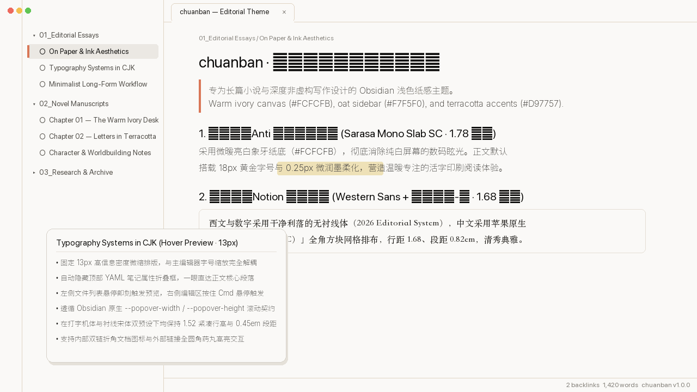

# chuanban — Warm Editorial & Long-Form Writing Theme for Obsidian



**chuanban** is a warm, high-contrast paper-and-ink light theme crafted for novelists, essayists, and deep long-form writers in Obsidian. It combines warm ivory and oat paper surfaces, terracotta accents, tactile ink-softening typography, high-density page preview popovers, and dual built-in CJK/Western typography presets.

---

## ✨ Key Features / 核心特性

### 1. Warm Ivory & Oat Editorial Palette (暖白象牙与燕麦纸感色彩体系)
- **Primary Reading Canvas (`#FCFCFB`)**: Micro-warm ivory paper surface that eliminates cold digital glare (`#FFFFFF`) while keeping crisp text contrast (`#1F1E1D`).
- **Sidebar & Navigation (`#F7F5F0`)**: Warm oat secondary background with deep oat active pills (`#ECE9E1`) and crisp `1px` dividers (`rgba(0, 0, 0, 0.14)`).
- **Terracotta Accent (`#D97757`)**: Used for active tabs, blockquotes, links, and focus indicators.
- **Eye-Care Selection & Highlight**: Soft sage-green text selection (`rgba(130, 175, 138, 0.24)`) + warm amber marker highlight (`rgba(232, 197, 110, 0.28)`).

### 2. Dual Built-in Typography Presets (双排版预设切换)
Switch seamlessly via the **Style Settings** plugin (`chuanban -> Typography Preset`), `body.preset-notion-serif` class, or per-note YAML `cssclasses: [preset-notion-serif]`:

| Feature | Preset 1: Typewriter Slab (Default / 默认) | Preset 2: Notion Serif (衬线宋体预设) |
| :--- | :--- | :--- |
| **Font Stack** | `Sarasa Mono Slab SC` (`等距更纱黑体 Slab SC`) | Western Sans (`SF Pro Text` / `Inter`) + `Songti SC` (`宋体-简` 全角方块排布) |
| **Line Height** | `1.78` | `1.68` |
| **Paragraph Gap** | `0.38em` (Live Preview) / `0.95em` (Reading) | `0.82em` (Live Preview) / `1.05em` (Reading) |
| **Ink Texture** | `0.25px` subtle ink-bleed softening | Crisp, un-shadowed serif strokes + `tabular-nums` & `full-width` CJK |

### 3. Decoupled High-Density Page Preview Popover (固定高信息量悬浮预览卡)
- Page preview popovers (`.popover.hover-popover`) are decoupled from the main editor's zoom level and locked at a crisp **`13px` / `1.52` line-height** (`440×360px` scrollable viewport).
- Automatically hides YAML frontmatter properties (`.metadata-container`) inside hover previews so you immediately see the body text.

---

## 🔤 Recommended Fonts / 推荐字体安装

For the best typography experience on macOS / Windows / Linux:
1. **Sarasa Mono Slab SC (`等距更纱黑体 Slab SC`)** — Recommended for Preset 1 (Typewriter Slab):
   ```bash
   brew install --cask font-sarasa-gothic
   ```
2. **Songti SC (`宋体-简`)** — Built into macOS for Preset 2 (Notion Serif).

---

## 📄 License

[MIT License](LICENSE) © 2026 chuanban ([Anarcadia](https://github.com/Anarcadia))
